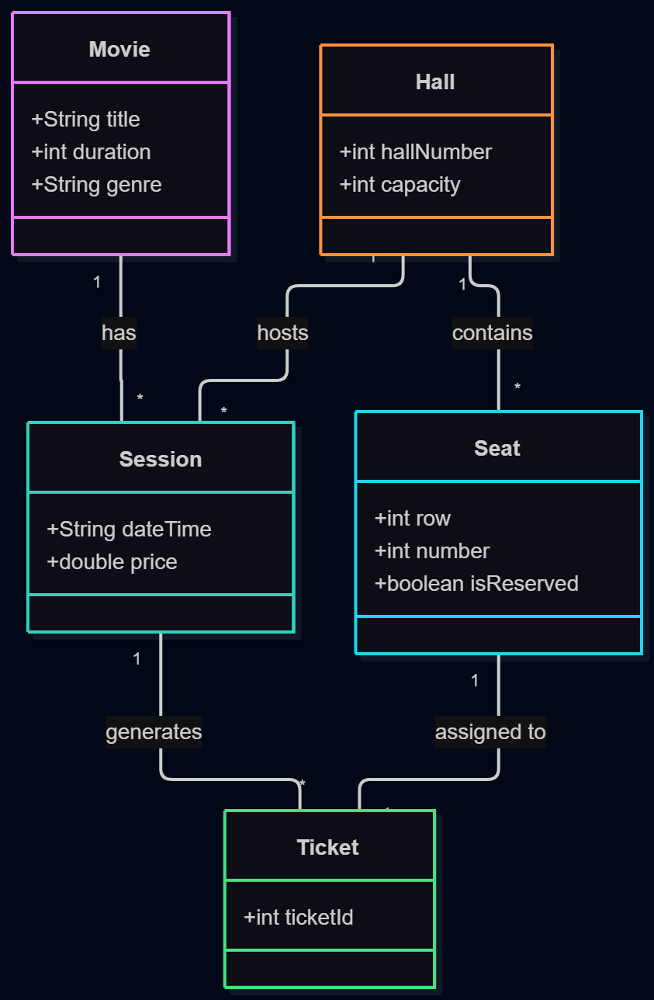

# Система бронювання квитків у кінотеатр

## Про що проект?
Програмне забезпечення для перегляду розкладу фільмів, вибору доступних місць у залі та оформлення квитків користувачами.

## Навіщо цей проект?
* Закріплення практичних навичок розробки додатків на мові програмування Java.
* Опрацювання роботи з об'єктами, структурами даних та моделюванням бізнес-логіки.

## Основний функціонал
1. Перегляд афіші та розкладу сеансів.
2. Вибір місця у глядацькій залі.
3. Оформлення та формування квитка.
4. Управління розкладом та сеансами.

## Концептуальна діаграма класів
